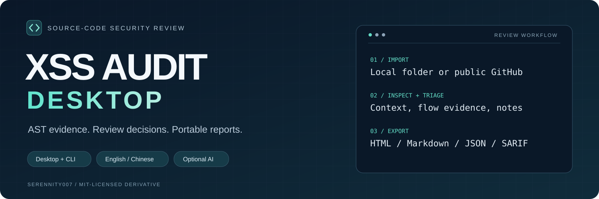

[English](README.md) · [简体中文](README.zh-CN.md)

<p align="center">
  
</p>

<p align="center">
  <a href="https://github.com/Serennity007/xss-audit-desktop/releases/latest"></a>
  
  
  <a href="LICENSE"></a>
</p>

# XSS Audit Desktop

[All projects by task](https://github.com/Serennity007/repo-catalog) · [Source recheck · 2026-10-30](docs/verification/2026-10-30-source.json)

**[Try the browser workbench](https://serennity007.github.io/xss-audit-desktop/)** — web workbench 0.3.0, independently hosted on GitHub Pages. Review source locally without an account or API key: ZIP/folder imports, downloadable project snapshots, source search, filtered batch review, limited AST evidence, conservative baselines and five export formats. The unchanged AST engine remains 0.2.0. [Web documentation](web/README.md) · [Browser changes](web/CHANGELOG.md) · [Verification and limits](docs/verification/web-0.3.0-local.json). Browser and desktop coverage differ.

Desktop **v0.4.0** includes baseline comparison in the desktop and CLI, distinguishing new, unchanged and no-longer-observed review signals. See the [usage guide](docs/USAGE.en.md#compare-scans). Planned extensions and acceptance conditions are in the [roadmap](docs/ROADMAP.md).
The same release packages project scan settings, per-file coverage, retained review history, status filtering and additional HTML/Python flow models. See [scan configuration and behavior changes](docs/SCAN-CONFIG.en.md).

The source also includes a [repository-auditor robustness research platform](docs/ROBUSTNESS.en.md): unchanged-source context pairs, bounded multi-file audit transcripts and separate detection, localization and evidence regression proxies. Run `python -m xss_audit.research_cli demo --output D:\audit-research\demo --offline-demo` for a scripted synthetic demonstration; it is not measured model performance.

**Review source code with the context, flow evidence and review decisions in one workbench.**

Open a local project or import a public GitHub repository. Inspect security signals in JavaScript, TypeScript and Python, record your decisions, and share searchable HTML or SARIF reports. Use the Windows desktop app for interactive review and the CLI for repeatable checks.

Local static scanning works without an API key. You can opt into AI review using your own endpoint, model and key.

**[Download Windows](https://github.com/Serennity007/xss-audit-desktop/releases/latest)** · [Try the demo](#try-the-included-example) · [Documentation](docs/README.md) · [Verification](docs/VERIFICATION.md) · [Contribute](CONTRIBUTING.md)

## Download and start

Download **[XSS-Audit-v0.4.0-windows-x64.zip](https://github.com/Serennity007/xss-audit-desktop/releases/download/v0.4.0/XSS-Audit-v0.4.0-windows-x64.zip)**, extract it, and choose an entrypoint:

| Program | Use it for |
| --- | --- |
| **`XSS-Audit-Desktop.exe`** | Import a project, scan, inspect evidence, save review decisions and export reports. |
| **`xss-audit-cli.exe`** | Run local or public-repository checks from a terminal, batch job or CI script. |

Both executables include English and Simplified Chinese and run **without installing Python**. The ZIP also includes guides, licenses, a synthetic audit fixture and example reports. AI review is available inside both programs.

Current binaries target Windows 10/11 x64 and were checked on Windows 11 x64. They are portable executables; there is no installer, code signature or automatic updater. Verify downloads against the release's `SHA256SUMS.txt` with `Get-FileHash -Algorithm SHA256`. Source users need Python 3.11+; macOS/Linux binaries are not published.

## What you can do

| Capability | What you get |
| --- | --- |
| **Import public GitHub code** | Accept a repository URL or `owner/repository`, with an optional branch, tag or commit. No Git installation is required. |
| **Inspect AST flow evidence** | Follow selected inputs through variables and string construction into HTML, navigation, dynamic execution and supported Python calls. Evidence includes source lines and bounded propagation steps. |
| **Review more than XSS** | Work through 20 review categories: the upstream 14 XSS categories plus SQL construction, shell execution, file paths, SSRF, deserialization and credentials. Depth varies by language/category. |
| **Triage in context** | Filter by priority, category or keyword. Inspect surrounding code and guidance. Save needs-review, confirmed-risk, false-positive or fixed decisions with local notes. |
| **Share the evidence** | Export Markdown, JSON, offline searchable HTML or SARIF 2.1.0. Keep findings, coverage notes and review context with the handoff. |
| **Choose AI scope** | Inspect the selected complete-file list before sending from the desktop app. Input prioritizes evidence-bearing files, masks recognized credentials on a best-effort basis and records omissions. |

### A review, step by step

1. **Choose the code.** Select a folder or import a public GitHub snapshot at the ref you want to examine.
2. **Inspect the signals.** Review priority, category, source context and available AST evidence. Check skipped files and analysis failures before interpreting coverage.
3. **Record your decision.** Add notes and triage status. Revisit saved decisions when related code changes.
4. **Export the review.** Share an offline report, save structured JSON, or use SARIF in a compatible review workflow. Add AI when you want another reading of the selected source scope.

## Try the included example

Scan the ZIP's `examples/demo-project/` folder in the desktop app, or inspect the committed [English HTML report](examples/demo-report.html), [Chinese HTML report](examples/demo-report.zh-CN.html) and [sample Markdown report](examples/sample-report.md).

The TypeScript fixture contains this intentionally risky flow:

```tsx
const text: string = new URLSearchParams(window.location.search).get("q") ?? "";
const html = "<p>" + text + "</p>";
document.querySelector("#unsafe-preview")!.innerHTML = html;
```

Inspect the query-string input, string construction and HTML write together. The same fixture contains a `textContent` comparison; selected AST HTML-write rules distinguish that text output from an HTML sink. The Python fixture includes a parameter-bound SQL comparison.

**The fixture is synthetic and deliberately risky. Scan it; do not run or deploy it.** Confirm the real application's input controls, output context and exploitability before calling a reported flow a vulnerability.

## Command line

Run from the extracted ZIP directory and create an output directory first:

```powershell
New-Item -ItemType Directory -Force .\reports | Out-Null

# Local project → offline HTML
.\xss-audit-cli.exe "D:\projects\web-app" --lang en --format html -o ".\reports\audit.html"

# Public repository at a chosen ref → SARIF
.\xss-audit-cli.exe --repo "owner/repository" --ref "main" --format sarif -o ".\reports\audit.sarif"

# Gate on high-priority signals not marked false positive or fixed
.\xss-audit-cli.exe "D:\projects\web-app" --min-priority high --ignore-reviewed --fail-on-match

.\xss-audit-cli.exe --help
```

Without `-o`, the CLI creates a timestamped report in the selected format. It does not overwrite existing output files. CLI filters affect exported results and the match gate; desktop filters affect the view while desktop export includes all signals.

| Exit code | Meaning |
| --- | --- |
| `0` | Completed. |
| `1` | `--fail-on-match` is enabled and review signals remain after filtering. This is a review gate, not a confirmed vulnerability count. |
| `2` | Error or incomplete scan/AST analysis; examine coverage notes. |
| `130` | Interrupted. |

## Optional AI review

Use a Responses-compatible or Chat Completions-compatible endpoint with your own credentials. The desktop app shows the selected source-file list before you confirm sending. In the CLI, `--ai` opts into sending that scope:

```powershell
# Configure your own OPENAI_API_KEY and XSS_AUDIT_MODEL first.
.\xss-audit-cli.exe "D:\projects\web-app" --ai --lang en -o ".\reports\ai-review.md"
```

The source budget is approximately **180,000 characters**. The client sends complete files, prioritizes AST evidence and rule signals, and lists omissions. It supplies the upstream playbook and Python review requirements; it does not automatically fetch the rest of the repository or batch more requests.

The app does not persist your API key. Secret masking cannot identify every credential; inspect the source scope before sending it. The provider controls access, billing and retention. AI transport and language handling have been checked with a local mock service; paid-model integration and audit quality have not been benchmarked. [AI configuration and data handling →](docs/USAGE.en.md#optional-ai-review)

## Coverage and interpretation

| Input | Current analysis |
| --- | --- |
| Standalone JS / JSX / MJS / CJS | Pattern search and limited Tree-sitter flow analysis. |
| Standalone TS / TSX | Pattern search and limited Tree-sitter flow analysis. |
| Python | Pattern search and selected standard-library AST flow analysis. |
| Vue / Svelte / Astro / MDX, HTML and supported templates | Pattern search; embedded scripts are not extracted for AST analysis. |
| Supported styles, SVG/XML and JSON | Applicable pattern rules; depth differs from source-file AST analysis. |

`High`, `Medium` and `Info` set **review priority**. Automated signals need human confirmation. The engine does not provide complete cross-file/cross-function analysis, dependency-advisory lookup or exploitability proof. A scan with no matches does not establish safety.

The scanner reads UTF-8/UTF-8 BOM files and skips common dependency, generated, cache and minified paths. It reports limits, read failures and parse failures. See [analysis boundaries](docs/ANALYSIS.en.md) and [scope/import limits](docs/USAGE.en.md#detection-boundaries).

## English and Chinese

English is the default. Use the desktop selector or CLI `--lang en` / `--lang zh-CN` for interface and report language. AI requests ask for the selected language. Code, paths, notes and existing AI responses remain verbatim; JSON/SARIF retain canonical identifiers and add localized display labels. [Language coverage →](docs/LANGUAGES.md)

## Develop and contribute

Maintained by [Serennity007](https://github.com/Serennity007). The [v0.4.0 verification record](docs/VERIFICATION.md) reports **148 regression tests: 145 passed, 3 skipped**, plus **17 frozen-CLI checks**. The [2026-10-30 source recheck](docs/verification/2026-10-30-source.json) reproduced the regression result in a fresh Python environment; the three skips require Windows symlink permission. Packaged executables and the web app were not retested in that source recheck.

```powershell
git clone https://github.com/Serennity007/xss-audit-desktop.git
cd xss-audit-desktop
python -m pip install .
python desktop.py
python -m xss_audit "examples/demo-project" --lang en
python -m unittest discover -s tests -v
```

Python 3.11+ is required. The GUI also needs Tkinter; the CLI does not. Source CLI users can run on other Python 3.11+ systems. [Windows builds and workflow status →](docs/USAGE.en.md#build-and-release)

Bug reports benefit from the version, language, coverage notes and a minimal sanitized example. Contributions to parser cases, evidence clarity, false-positive handling, reports and translations are welcome. Use [issues](https://github.com/Serennity007/xss-audit-desktop/issues) or submit a pull request; remove credentials and private source before sharing.

**[Contribution guide](CONTRIBUTING.md)** · [Detection feedback](https://github.com/Serennity007/xss-audit-desktop/issues/new?template=detection_feedback.yml) · [Security policy](SECURITY.md) · [Changelog](CHANGELOG.md)

For a vulnerability in this application, use [private vulnerability reporting](https://github.com/Serennity007/xss-audit-desktop/security/advisories/new). Use public issue forms for sanitized bugs, detection feedback and workflow requests.

## Credits and license

Independent derivative of **[songjianyang/xss-audit](https://github.com/songjianyang/xss-audit)**, an MIT-licensed audit Skill. This repository adds the desktop app, CLI, scanner, limited AST analysis, optional AI transport and packaging. It retains the [original playbook](SKILL.md), [upstream README](docs/UPSTREAM-README.md) and attribution. The upstream author has not endorsed this derivative.

[MIT License](LICENSE) · [Attribution](NOTICE.md) · [Parser notices](THIRD-PARTY-NOTICES.txt) · [v0.4.0 release notes](docs/RELEASE-v0.4.0.md)

Review code you own or are authorized to assess.
